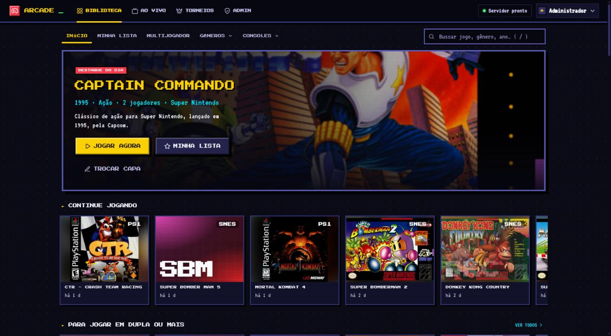
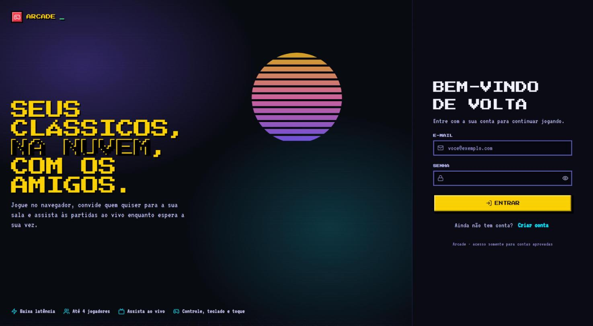
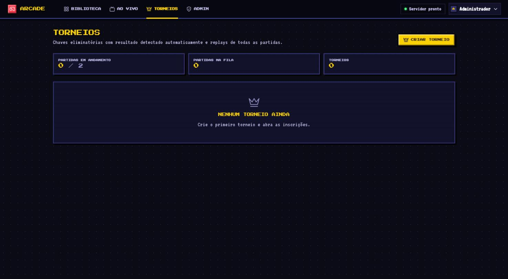
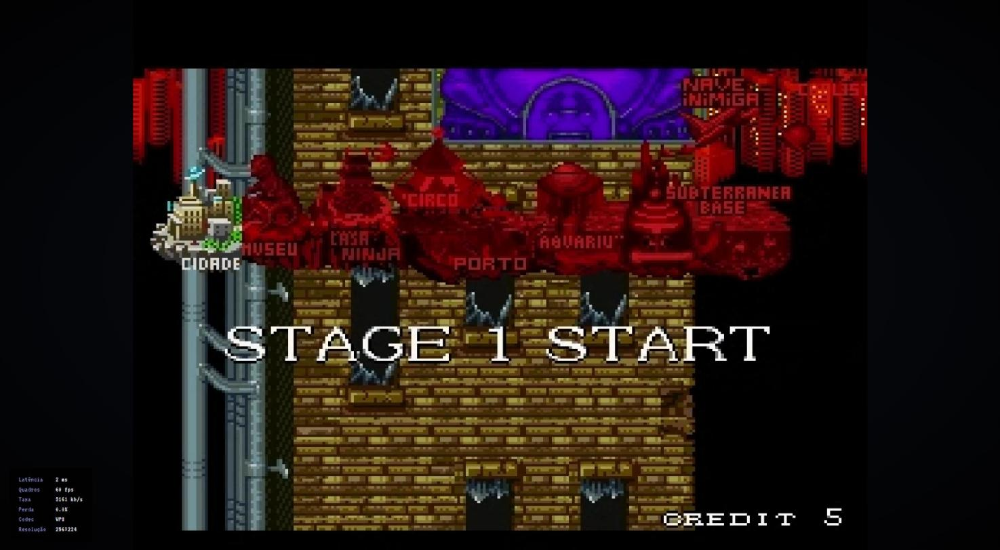
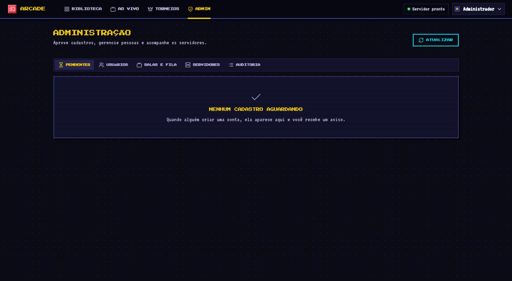

# Belko Arcade

Plataforma privada de jogos retrô na nuvem, toda em português. Os jogos rodam no servidor e o vídeo e o
áudio chegam ao navegador por WebRTC, com baixa latência. O acesso é só para contas aprovadas pelo
administrador.

> **Projeto original:** este trabalho é um *fork* do **[CloudRetro / cloud-game](https://github.com/giongto35/cloud-game)**,
> de [giongto35](https://github.com/giongto35) e colaboradores, licenciado sob a licença do repositório original.
> Todo o núcleo de streaming, emulação e WebRTC vem do trabalho deles. Veja os [créditos](#créditos) abaixo.



## Novidades em relação ao original

- **Interface 100% em português (pt-BR)** com visual retrô e tema escuro.
- **Contas com aprovação:** cadastro, login e aprovação manual pelo administrador (papel opcional de moderador).
- **Multijogador online** com papéis (anfitrião, jogadores 1–4 e espectadores) e salas por link.
- **Fila de espera** com transmissão ao vivo para quem aguarda a vez.
- **Torneios** com chaves eliminatórias, resultado detectado automaticamente pela memória do jogo e replays
  das partidas (Ultimate Mortal Kombat 3, Super Bomberman 2 e Super Mario Kart).
- **Biblioteca com capas e catálogo:** capas do libretro-thumbnails e dados (gênero, ano, desenvolvedora,
  jogadores) baixados uma única vez e guardados localmente; troca de capa e upload de ROMs pelo painel.
- **Painel de administração:** pendentes, usuários, salas e fila, servidores e auditoria.
- **Controle, teclado, mouse e toque**, com suporte a gamepad.
- **Pronto para produção:** Docker Compose para Coolify com deploy automático.

## Telas

| Entrada | Torneios |
|---|---|
|  |  |

| Jogo em andamento | Administração |
|---|---|
|  |  |

## Início rápido (Docker)

```bash
echo "BELKO_ADMIN_PASSWORD=troque-esta-senha" > .env
docker compose up --build    # http://localhost:8000, entre com wenderson@belko.com.br
```

Coloque as ROMs em `assets/games/<sistema>/`. Os cores Libretro são baixados automaticamente.

## Documentação

- [Plano do projeto](docs/plano/README.md)
- [Como rodar e administrar](docs/plano/05-operacao.md)
- [Torneios](docs/plano/06-torneios.md)
- [Subir no Coolify com deploy automático](docs/plano/07-coolify.md)
- [Documento de design v2 (original)](DESIGNv2.md)

## Ambiente de desenvolvimento

* Instale o [Go](https://golang.org/doc/install)
* Instale o GStreamer

```
# Ubuntu / Windows (WSL2)
apt-get install -y make gcc pkg-config libgstreamer1.0-dev libgstreamer-plugins-base1.0-dev gstreamer1.0-plugins-good

# macOS
brew install pkg-config gstreamer gst-plugins-base gst-plugins-good

# Windows (MSYS2)
pacman -Sy --noconfirm --needed git make mingw-w64-ucrt-x86_64-{gcc,pkgconf,gstreamer,gst-plugins-base,gst-plugins-good}
```

O coordenador e os workers precisam rodar ao mesmo tempo; os workers se conectam ao coordenador.

1. Por script: `make dev.run` (cria dois processos, um em segundo plano e outro em primeiro plano).
2. Manualmente, em duas sessões:
   * `go run cmd/coordinator/main.go` sobe o coordenador
   * `go run cmd/worker/main.go --coordinatorhost localhost:8000` sobe um worker

Para rodar cores que usam OpenGL, instale e configure um servidor `X` (Xvfb). Veja o `docker-compose.yml`
para um exemplo.

## Configuração

A configuração padrão fica em [`pkg/config/config.yaml`](pkg/config/config.yaml) e é embutida nos
aplicativos. Para alterar, use variáveis de ambiente com o prefixo `CLOUD_GAME_`, ou coloque um
`config.yaml` ao lado do aplicativo, na pasta `.cr` do usuário, ou em um diretório indicado com `-w-conf`
(`worker -w-conf /usr/conf`). A lista completa de chaves está em
[`05-operacao.md`](docs/plano/05-operacao.md).

## Produção

Guia passo a passo com Coolify, domínio HTTPS, WebRTC (UDP 8443) e auto deploy:
[`docs/plano/07-coolify.md`](docs/plano/07-coolify.md). O arquivo de produção é o
[`docker-compose.coolify.yml`](docker-compose.coolify.yml).

## Documentos técnicos do projeto original

- [Open Source Cloud Gaming with WebRTC (webrtchacks)](https://webrtchacks.com/open-source-cloud-gaming-with-webrtc/)
- [Vídeo de demonstração do CloudRetro](https://www.youtube.com/watch?v=GUBrJGAxZZg)
- [Wiki do projeto original (desatualizada)](https://github.com/giongto35/cloud-game/wiki)
- [FAQ do projeto original](https://github.com/giongto35/cloud-game/wiki/FAQ)
- [Guia do código (Code Deep Dive)](https://github.com/giongto35/cloud-game/wiki/Code-Deep-Dive)

## Créditos

**Projeto original: [CloudRetro (giongto35/cloud-game)](https://github.com/giongto35/cloud-game)**,
um serviço de cloud gaming de código aberto para jogos retrô. Obrigado a
[todas as pessoas que contribuíram](https://github.com/giongto35/cloud-game/graphs/contributors).

Autores originais:

- Nguyen Huu Thanh (https://www.linkedin.com/in/huuthanhnguyen)
- Tri Dang Minh (https://trich.im)

Mantenedor:

- Sergey Stepanov (https://github.com/sergystepanov)

Projeto irmão dos autores: [CloudMorph](https://github.com/giongto35/cloud-morph), uma abordagem mais
genérica para rodar qualquer jogo ou aplicativo offline no navegador.

Agradecimentos:

* Equipe do [Pion](https://github.com/pion), pela biblioteca de WebRTC em Go.
* Equipe do [Libretro](https://www.libretro.com), pela biblioteca de emulação, e o
  [libretro-thumbnails](https://github.com/libretro-thumbnails/libretro-thumbnails) e o
  [libretro-database](https://github.com/libretro/libretro-database), fontes das capas e do catálogo.
* [kivutar](https://github.com/kivutar), por [go-nanoarch](https://github.com/libretro/go-nanoarch) e
  [ludo](https://github.com/libretro/ludo).
* [gen2brain](https://github.com/gen2brain), pelo codificador [h264](https://github.com/gen2brain/x264-go) e VPX.
* [poi5305](https://github.com/poi5305), pela [codificação de vídeo YUV](https://github.com/poi5305/go-yuv2webRTC).
* [fogleman](https://github.com/fogleman), pelo [emulador de NES](https://github.com/fogleman/nes).

#### Arte (projeto original)

* [October 2nd - Gameboy poltergeist](https://www.deviantart.com/wanyo/art/October-2nd-Gameboy-poltergeist-707754217),
  de [Wayne Kubiak (wanyo)](https://www.deviantart.com/wanyo)
* [1978](http://simoncpage.co.uk/blog/2009/01/retro-art-wallpaper/), de [Simon C Page](http://simoncpage.co.uk/)
* [Linear Video game controller background Gadgets seamless pattern](https://stock.adobe.com/ru/images/linear-video-game-controller-background-gadgets-seamless-pattern/241143639),
  de [Anna](https://stock.adobe.com/contributor/208277224/anna)

## Licença

Mantida a licença do projeto original. Veja o arquivo [`LICENSE`](LICENSE).
As capas pertencem aos respectivos detentores dos direitos; as ROMs não fazem parte do repositório e
cada pessoa é responsável por usar apenas jogos que tenha o direito de usar.
